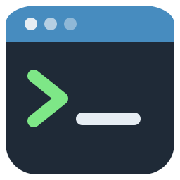

<p align="center"></p>

<h1 align="center">gdcli</h1>

<p align="center">
  <a href="https://www.npmjs.com/package/@spardanviro/gdcli"></a>
  <a href="https://godotengine.org/asset-library/asset/5539"></a>
  <a href="https://github.com/spardanviro/GodotCli/actions/workflows/ci.yml"></a>
  
  <a href="LICENSE"></a>
</p>

<p align="center"><b>让 Claude Code、Codex、Cursor 或任何 MCP 智能体，通过真正的 Godot 编辑器帮你做 Godot 4 游戏。</b></p>

<p align="center"><a href="README.md">English</a> | <b>简体中文</b></p>

---

gdcli 把编码智能体接到正在运行的 Godot 编辑器上。你用大白话说要什么功能（"一个能左右跑、能跳的 2D 角色，脚下有地面"），
智能体就像人一样在编辑器里把它做出来：建节点、设属性、写脚本并挂上、画瓦片、做动画，每一步都在编辑器的撤销栈里。
然后它运行游戏，按键、读运行中的数值，确认角色真的跳起来了。

支持官方发布的 Godot 4.3 到 4.7（标准版和 .NET 版），Windows、macOS、Linux 都能用。不需要重新编译引擎，也不用把 API
密钥填进 Godot：思考交给你已经在用的智能体，gdcli 给它在编辑器里的手和眼睛。

```text
你：    做一个 2D 平台跳跃角色，能左右移动和跳跃，脚下有地面。做完运行确认。

智能体：gd command scene_new --path res://main.tscn --root-type Node2D
        gd command node_create --type CharacterBody2D --name Player --properties '{"position": [200, 300]}'
        gd command node_create --type CollisionShape2D --parent Player --properties '{"shape": {"$new": "RectangleShape2D", ...}}'
        gd command fs_write_text --path res://player.gd --text-file /tmp/player.gd
        gd command node_attach_script --path Player --script res://player.gd
        gd command project_input_map_set --action jump --events '[{"key": "Space"}]' --yes
        gd command scene_save
        gd command editor_play
        gd command game_input --action jump --hold 0.1
        gd command game_node_get --path Main/Player --properties '["velocity", "position"]'   # 往上走了：完成
```

## 为什么要这样做

让 AI 写 Godot 游戏，常见做法是让它直接改 `.tscn` 和 `.gd` 文件。这样有几个问题：

- 场景文件的格式容易写坏。
- 改动不进编辑器的撤销栈。
- 模型看不到游戏实际跑起来是什么样。
- 它写的任何代码都可能被加载进你的编辑器里运行。

gdcli 换了一条路：**智能体通过编辑器来做事。**

| | 直接改文件 | 用 gdcli |
|---|---|---|
| 场景和节点 | 手写 `.tscn` 文本，id 和路径靠猜 | 72 条结构化命令，文件由编辑器来写 |
| 撤销 | 没有 | 每个改动都是编辑器撤销栈里的一步，`Ctrl+Z` 有效 |
| 看结果 | 最多只能看游戏打印的文字 | 读写运行中游戏的数值、模拟输入、截图、断点、局部变量 |
| 编辑器里没保存的内容 | 被覆盖或被无视 | 就是人在编辑器里看到的那个场景，实时同步 |
| 在编辑器里运行的代码 | 写进去什么就运行什么 | `@tool` 脚本、插件、自动加载、C#、`eval` 都要人在编辑器里点"允许" |
| 引擎知识 | 靠模型自己记得 | 17 个技能讲 Godot 4 的坑和做法，查得到所装版本的接口和官方手册 |

## 能做什么

- **搭场景**：节点、属性、脚本、信号、分组、资源、动画（AnimationPlayer、状态机、混合空间、帧动画）、带地形自动拼接的瓦片集和瓦片地图、GridMap 关卡、主题、导航网格、导入设置、现成的粒子效果和动画、按图形自动生成的碰撞形状。
- **改项目**：项目设置、输入动作，移动和重命名文件时自动更新场景和脚本里的引用。
- **运行并往里看**：从编辑器运行游戏，读它的节点树和实时数值，发送按键、鼠标、手柄的操作序列，放慢或加快游戏，列出界面上显示的内容，一次检查多个数值，调用方法，读带脚本调用栈的报错和输出，截图，看帧率、内存、绘制调用和孤立节点。
- **调试**：下断点、暂停、单步，看停住时的调用栈和局部变量。
- **不开编辑器**：运行场景并拿到带文件和行号的报错，检查脚本，运行 GUT 或 gdUnit4 测试，导入，导出，运行 SceneTree 脚本，查所装 Godot 版本的任意类，搜官方手册。
- **任何智能体都能用**：同一套命令，是命令行（`gd`），是 Claude 插件，也是给 Codex、Cursor、VS Code、Gemini CLI 等用的 MCP 服务器。

## 三个组成部分

| 部分 | 是什么 | 是否必需 | 安装方式 |
|---|---|---|---|
| **桥接**（`addons/gdcli`） | 编辑器插件（GDScript）。在 `127.0.0.1` 上监听，执行命令，管撤销栈，需要时请人批准 | 必需，凡是操作打开的编辑器都要它 | `gd bridge install`、[Godot 资源库](https://godotengine.org/asset-library/asset/5539)，或 [Releases](https://github.com/spardanviro/GodotCli/releases) 里的 zip |
| **`gd` 命令行** | 找到编辑器、发命令、输出结果；也能自己启动 Godot 做离线的事；还是一个 MCP 服务器 | 必需 | `npm install -g @spardanviro/gdcli` |
| **Claude 插件**（`godot@gdcli`） | 17 个技能（怎么用 `gd`、Godot 4 该怎么用）和 3 个钩子（会话开始时的提醒、拦住绕过编辑器直接写项目文件） | 可选，用 Claude 时推荐装；其他智能体用 `gd skills install` 拿到同样的技能 | 插件市场，或在 Claude 应用里上传 [Releases](https://github.com/spardanviro/GodotCli/releases) 里的 zip |

```text
 智能体 / 终端                        Godot 编辑器
┌──────────────┐   HTTP（本机回环）   ┌──────────────────────────────┐
│ gd command … │ ──────────────────▶ │ 桥接 addons/gdcli            │──▶ 场景、撤销栈、文件
│ gd mcp       │   令牌 + 握手        │   需要时弹窗请人批准           │──▶ 运行中的游戏（调试器）
└──────┬───────┘                     └──────────────────────────────┘
       │ 直接启动 Godot（不经过编辑器）
       └──▶ gd run / check / test / import / export / api / docs
```

桥接只监听本机回环地址，令牌保存在用户目录（`~/.gdcli`）里，每次连接都先用 HMAC 握手，确认对方真的持有令牌。细节见 [docs/protocol.md](docs/protocol.md)。

## 上手教程

### 1. 准备

- **Godot 4.3 或更新**，任何官方版本（标准版或 .NET 版）。gdcli 不负责安装 Godot。
- **Node.js 22 或更新**，用来装 `gd` 命令行。
- 智能体：[Claude Code](https://claude.com/claude-code)，或任何 MCP 客户端（Codex、Cursor、VS Code、Gemini CLI……）。

### 2. 装命令行，告诉它 Godot 在哪

```bash
npm install -g @spardanviro/gdcli
gd doctor
```

`gd doctor` 会告诉你找到了哪个 Godot、还缺什么。`gd` 按这个顺序找 Godot：

1. `--godot <路径>`
2. 环境变量 `GODOT_BIN`
3. `~/.gdcli/config.json` 里的 `godot_bin`
4. PATH 上的 `godot`，再是 `godot4`

Windows 上请指向编辑器旁边的 `*_console.exe`，这样才能读到它的输出。

`gd` 和 `gdcli` 是同一个命令。如果 `gd` 被 shell 别名占用（oh-my-zsh 的 git 插件把它设成了 `git diff`），就用 `gdcli`，或者 `unalias gd`。

### 3. 把桥接装进项目

三种方式任选一种：

**a. 用 `gd` 装（推荐）**：装的永远是和 `gd` 同一个版本的桥接。

```bash
gd new my-game --renderer mobile   # 新建项目，桥接已经装好
                                   # （渲染器：forward_plus、mobile、gl_compatibility）
# 已有项目：
cd your-game
gd bridge install                  # 复制 addons/gdcli 并启用；换版本时加 --force
```

**b. 在编辑器里从 Godot 资源库装**：

1. 用 Godot 打开项目，切到顶部的 **AssetLib**（资源库）标签。
2. 搜索 **gdcli**，打开 "gdcli bridge"，点 **Download**（下载），再点 **Install**（安装），保持 `addons/gdcli` 勾选。
3. **项目 > 项目设置 > 插件**，勾上 gdcli 的**启用**。启用时会顺带加上一个很小的自动加载 `GdcliGame`，`gd` 靠它查看运行中的游戏。

资源库页面是 [godotengine.org/asset-library/asset/5539](https://godotengine.org/asset-library/asset/5539)。新版本等审核时，资源库可能落后一个版本；项目里的桥接和 `gd` 版本不一致时 `gd` 会提醒，`gd bridge install --force` 可以换成匹配的版本。

**c. 用 Release 里的 zip**：从 [Releases](https://github.com/spardanviro/GodotCli/releases) 下载 `gdcli-bridge-<版本>.zip`，把里面的 `addons/gdcli` 文件夹复制到项目的 `addons/` 下，然后按 b.3 启用。

### 4. 打开编辑器，确认连上了

```bash
gd open          # 用这个项目启动编辑器（也可以照常自己打开）
gd status        # 列出 gd 能连上的编辑器，应该能看到你的项目
```

在没有显示器的机器上（服务器、持续集成、没有桌面的 WSL），用 `gd host start` 起一个无头编辑器，`gd host stop` 关掉。

### 5. 自己先试几条命令

```bash
gd command scene_new --path res://main.tscn --root-type Node2D --root-name Main
gd command node_create --type Sprite2D --name Logo --properties '{"position": [100, 50]}'
gd command scene_tree
gd command edit_undo                  # 和在编辑器里按 Ctrl+Z 一样
gd command edit_redo
gd command scene_save
gd run --headless --seconds 3         # 不开编辑器跑 3 秒，把报错整理好返回
```

每条命令执行时，编辑器里都能看到变化。`gd list` 列出编辑器提供的全部命令和参数（加 `--json` 是完整的参数结构）。

### 6. 交给智能体

#### Claude Code

装插件（可选，但它会教 Claude 怎么用好 `gd`）：

```bash
claude plugin marketplace add spardanviro/GodotCli
claude plugin install godot@gdcli
```

不用插件市场的话，从 [Releases](https://github.com/spardanviro/GodotCli/releases) 下载 `gdcli-claude-plugin-<版本>.zip`：

- **Claude 桌面应用**：自定义（Customize）> 插件（Plugins）> 添加（Add）> **上传插件（Upload plugin）**，选这个 zip。技能和钩子在本机运行的会话里生效（Cowork、Claude Code），那里装着 `gd`。claude.ai 网页版的聊天只加载技能，也连不到你的编辑器。
- **Claude Code，只用于这一次会话**：`claude --plugin-dir gdcli-claude-plugin-<版本>.zip`，或 `claude --plugin-url <zip 在 Release 上的地址>`。

详见 [plugin/README.md](plugin/README.md)。

然后在项目文件夹里打开 Claude Code，直接说要做什么，比如：

> 做一个 2D 平台跳跃角色，能跑能跳，脚下有地面可以站。运行一下，确认跳跃正常。

> 敌人会穿墙，查一下原因并修好。

> 加一个暂停菜单，按 Esc 打开，有"继续"和"退出"，确认游戏真的停住了。

> 把主菜单翻译成中文和日文，再加一个切换语言的选项。

接下来会发生的事：

- 技能在需要时自动加载：`godot-cli` 管命令，再加上对应主题或任务的技能（瓦片地图、界面、着色器、联机、排错……）。
- Claude 通过 `gd command ...` 来搭建，你在编辑器里看着它变化。在编辑器里按 `Ctrl+Z` 能撤销它的步骤，和撤销你自己的一样。
- 改动会让代码在编辑器里运行时（`@tool` 脚本、插件、自动加载、C#），编辑器会弹出对话框显示完整内容，你点**允许**之前什么都不会发生。
- 它会自己检查：用 `gd run` 看报错，用游戏命令看行为。
- 插件的钩子会拦住 Claude 绕过编辑器、直接往磁盘写脚本和场景。这是护栏，不是沙箱；要有真正的边界，请按 [plugin/README.md](plugin/README.md) 配合 Claude Code 的沙箱使用。

#### Codex、Cursor、VS Code、Gemini CLI 等 MCP 客户端

`gd mcp` 是一个标准输入输出上的 MCP 服务器：编辑器的每条命令是一个同名工具，另有 `gd_run`、`gd_check`、`gd_test`、`gd_api_*`、`gd_docs_*`、`gd_host_start` 等不需要编辑器的工具。

```bash
gd mcp configure codex                # 先显示要写进 ~/.codex/config.toml 的条目
gd mcp configure codex --yes          # 写入
gd mcp configure cursor --yes         # cursor、vscode、gemini、claude 写进项目里对应的配置文件
gd skills install codex --yes         # 把 17 个技能装进 ~/.codex/skills（同一种 SKILL.md 格式）
gd skills install --dir <目录> --yes   # 其他读 SKILL.md 的智能体
```

有工具数上限的客户端或较小的模型，可以只取部分分组：`gd mcp --tools core,game`（分组：core、game、animation、level、import、docs、test、exec、custom；`gd mcp configure` 也接受这个选项）。只读命令同时以 MCP 资源的形式提供（`godot://scene/tree`、`godot://node/{path}`、`godot://file/{path}`、`godot://class/{name}` 等），客户端可以直接把它们附进对话。

工具让智能体能做事，技能告诉它怎么做才对。人工批准的规则对所有客户端都一样。

## 手把手：做一个会跳的角色

和智能体走的是同一套流程，一步一步来，看清每条命令在做什么。前提：项目里装了桥接，编辑器开着。

```bash
# 一个场景，里面有角色和地面。
gd command scene_new --path res://main.tscn --root-type Node2D --root-name Main
gd command node_create --type CharacterBody2D --name Player --properties '{"position": [200, 200]}'
gd command node_create --type ColorRect --parent Player \
  --properties '{"position": [-50, -50], "size": [100, 100], "color": "#4a90d9"}'
gd command node_create --type CollisionShape2D --parent Player \
  --properties '{"shape": {"$new": "RectangleShape2D", "properties": {"size": [100, 100]}}}'
gd command node_create --type StaticBody2D --name Floor --properties '{"position": [400, 500]}'
gd command node_create --type CollisionShape2D --parent Floor \
  --properties '{"shape": {"$new": "RectangleShape2D", "properties": {"size": [800, 40]}}}'

# 脚本要读的输入动作。
gd command project_input_map_set --action move_left --events '[{"key": "A"}, {"key": "Left"}]' --yes
gd command project_input_map_set --action move_right --events '[{"key": "D"}, {"key": "Right"}]' --yes
gd command project_input_map_set --action jump --events '[{"key": "Space"}]' --yes
```

把脚本写进一个临时文件（`player.gd`）：

```gdscript
extends CharacterBody2D

const SPEED := 300.0
const JUMP_VELOCITY := -600.0


func _physics_process(delta: float) -> void:
	if not is_on_floor():
		velocity += get_gravity() * delta
	if Input.is_action_just_pressed("jump") and is_on_floor():
		velocity.y = JUMP_VELOCITY
	velocity.x = Input.get_axis("move_left", "move_right") * SPEED
	move_and_slide()
```

```bash
# 写进项目、挂到节点上、保存。
gd command fs_write_text --path res://player.gd --text-file player.gd
gd command node_attach_script --path Player --script res://player.gd
gd command project_settings_set --name application/run/main_scene --value '"res://main.tscn"' --yes
gd command scene_save

# 能编译吗？跑起来有没有报错？
gd check res://player.gd
gd run --seconds 3 --headless

# 行为对不对？从编辑器运行，往里看。
gd command editor_play
gd command game_node_get --path Main/Player --properties '["position", "velocity"]'
gd command game_input --action jump --hold 0.1
gd command game_node_get --path Main/Player --properties '["position", "velocity"]'   # velocity.y < 0：跳起来了
gd command game_performance                                                           # 帧率、每帧耗时、节点数
gd command editor_stop
```

不对劲？在某一行停下来看：

```bash
gd command editor_play
gd command game_breakpoint --path res://player.gd --line 12
gd command game_debug        # 停住了吗？停在哪、为什么
gd command game_locals       # 那一行的局部变量（delta）
gd command game_breakpoint --path res://player.gd --line 12 --enabled false
gd command game_continue
gd command editor_stop
```

输入动作和主场景后面带 `--yes`：它们改的是项目设置，桥接把这类改动算作破坏性的，要求确认。

带瓦片和检查的完整版本见 [plugin/skills/godot-cli/references/walkthrough-platformer.md](plugin/skills/godot-cli/references/walkthrough-platformer.md)。

## gdcli 和 Godot AI 的区别

gdcli 和 [Godot AI](https://github.com/spardanviro/Godot_AI) 是同一个作者，两条路通向同一个目标。

| | gdcli（本项目） | Godot AI |
|---|---|---|
| 是什么 | 编辑器插件（GDScript）+ 命令行（`gd`，npm）+ Claude 插件 | 原生 C++ 模块，编译进自己构建的引擎 |
| Godot 版本 | 官方版本 4.3 到 4.7，标准版和 .NET 版 | 从源码构建的 4.7+（godot-master） |
| 安装 | 资源库或 `gd bridge install`；`npm install` | 带上这个模块从源码编译编辑器 |
| AI 在哪 | 在编辑器外：你已经在用的智能体（Claude Code、Codex、Cursor、Gemini CLI、任何 MCP 客户端），用它自己的账号 | 停靠在编辑器里的聊天面板；你填 Anthropic、OpenAI、Gemini、DeepSeek 或 GLM 的 API 密钥 |
| 怎么改东西 | 结构化命令，每条都是编辑器里可撤销的一步；自由代码（`eval`）默认关闭，每次都要人批准 | 工具调用加上生成的 `EditorScript` 代码在编辑器里执行，有权限、检查点和安全检查 |
| 运行中的游戏 | 查看、操控、调试：数值、输入、调用、截图、断点、局部变量、性能 | 在面板里监控报错并修复 |
| 不开编辑器 | `gd run`、`check`、`test`、`import`、`export`、`api`、`docs` | 只在编辑器里工作 |
| 适合 | 用官方稳定版 Godot，在终端或 IDE 里配合编码智能体；自动化和持续集成 | 想要编辑器里自带一个助手面板，自己选模型 |

两者共享 Godot 知识：为 Godot AI 整理的那些坑，成了 gdcli 技能里的参考资料。

## 命令速查

**需要编辑器**（桥接运行在打开的或无头的编辑器里）

| 命令 | 作用 |
|---|---|
| `gd status` / `gd list` | 能连上的编辑器 / 它提供的命令 |
| `gd command <名字> [--参数 值]` | 执行一条编辑器命令，参数也可以用 `--args '<json>'` 或 `--<参数>-file <文件>` 给 |
| `gd host start` / `gd host stop` | 没开编辑器时起一个无头编辑器 / 关掉它 |
| `gd eval <代码>` | 在编辑器里执行 GDScript（默认关闭，要在编辑器设置里打开，每次都要人批准） |

编辑器命令按类别：

| 类别 | 命令 |
|---|---|
| 场景 | `scene_new` `scene_open` `scene_save` `scene_tree` `scene_list_open` |
| 节点 | `node_create` `node_get` `node_set` `node_find` `node_move` `node_rename` `node_duplicate` `node_delete` `node_instantiate_scene` `node_attach_script` `node_connect_signal` `node_disconnect_signal` `node_connections` `node_add_to_group` `node_remove_from_group` |
| 文件与资源 | `fs_list` `fs_read_text` `fs_write_text` `fs_edit_text` `fs_move` `fs_delete` `fs_scan` `resource_create` `resource_get` `resource_set` `import_settings_get` `import_settings_set` |
| 项目 | `project_settings_get` `project_settings_set` `project_input_map` `project_input_map_set` |
| 动画 | `animation_create` `animation_list` `animation_state_machine_create` `animation_blend_space_create` `sprite_frames_create` |
| 效果与形状 | `preset_create` `collision_shape_fit` `theme_set` |
| 3D 关卡 | `gridmap_library_add` `gridmap_set_cells` `gridmap_get` |
| 项目分析 | `project_analyze` |
| 瓦片与导航 | `tileset_add_atlas` `tileset_set_collision` `tileset_set_terrain` `tilemap_set_cells` `tilemap_get` `navigation_bake` |
| 批量 | `batch`（可撤销的步骤和只读命令；一步失败就撤销已做的步骤） |
| 编辑器 | `editor_status` `editor_play` `editor_stop` `editor_errors` `editor_selection` `editor_select` `editor_screenshot` `edit_undo` `edit_redo` |
| 运行中的游戏 | `game_tree` `game_node_get` `game_node_set` `game_call` `game_input` `game_output` `game_errors` `game_input_events` `game_speed` `game_ui` `game_expect` `game_screenshot` `game_performance` |
| 调试 | `game_breakpoint` `game_pause` `game_step` `game_continue` `game_debug` `game_locals` |

项目还可以在 `res://gdcli_commands/` 里加自己的命令。

**不需要编辑器**（`gd` 自己启动 Godot）

| 命令 | 作用 |
|---|---|
| `gd run [场景] [--seconds N] [--headless]` | 运行项目或某个场景，返回整理好的报错（文件、行号、调用栈） |
| `gd check <脚本>…` | 检查脚本能否编译 |
| `gd test [路径…] [--framework gut\|gdunit4] [--select 文字] [--junit 文件]` | 无头运行项目里的 GUT 或 gdUnit4 测试，列出每个失败的测试 |
| `gd import` / `gd export <预设> <输出> [--debug\|--pack]` | 导入资源 / 导出游戏 |
| `gd exec <脚本> [-- 参数]` | 无头运行一个 SceneTree 脚本 |
| `gd api class <类名> [--member 成员]` / `gd api search <文字>` | 查所装 Godot 版本的接口 |
| `gd docs install` / `search` / `page` | 下载当前版本的官方手册（只取文本）并检索 |

**项目与安装**：`gd new`、`gd bridge install`、`gd bridge status`、`gd open`、`gd doctor`。

**全局选项**：`--json`、`--project <路径>`、`--godot <路径>`、`--instance <id>`（同一项目开着多个编辑器时选一个）、`--timeout <秒>`、`--yes`（确认覆盖或删除）、`--dry-run`（只说会改什么，不改）。

## 输出格式

任何命令加 `--json`，标准输出就是一个固定结构的信封，失败时也是：

```json
{
  "success": true,
  "command": "node_create",
  "data": { "path": "Logo", "type": "Sprite2D" },
  "errors": [],
  "warnings": [],
  "meta": { "protocol": 1, "undo": "gdcli: node_create Logo", "scene": "res://main.tscn" }
}
```

失败时 `errors` 里每一项都有 `code`、`message`、`hint`、`details`。退出码：0 成功，1 内部错误，2 用法或参数错误，3 认证失败，4 前置条件不满足（没有编辑器、要确认、人拒绝了），5 暂时性失败、稍后重试，6 命令执行失败。

## 安全模型

- **一般的改动**（建节点、改属性、写普通脚本）直接执行，并进入撤销栈。
- **破坏性的改动**（删除、覆盖、改项目设置）要调用方带上 `--yes`。这是减速带，不是授权。
- **会让代码进入编辑器进程的改动**，一律等人批准：`@tool` 脚本、内嵌脚本的场景和资源、任何 C# 文件、`addons/`、自动加载和其他决定加载哪些代码的项目设置、.NET 构建会读取的文件，以及 `eval`。对话框里显示完整内容，调用方说什么都不算数。无头编辑器没人可问，一律拒绝。
- **访问模式**存在编辑器设置里（每个用户一份，不随项目走）：`standard`（默认）、`ask`（每个破坏性操作都要人批准）、`readonly`（只读），以及 `full`（谁都不问，给无人值守的无头编辑器和持续集成用）。
- 游戏本身的代码以你的权限运行，这和你自己按 F5 一样。要限制它，请在智能体客户端里不要自动放行写文件和运行游戏。

完整规则见 [docs/protocol.md](docs/protocol.md) 第 4 节。

## 常见问题

**`gd` 找不到 Godot**：运行 `gd doctor`。用 `--godot`、`GODOT_BIN` 或 `~/.gdcli/config.json` 指定；Windows 上要指向 `*_console.exe`。

**`NO_EDITOR`**：编辑器没开，或者项目里没有桥接。先 `gd bridge install`，再 `gd open`；没有显示器时用 `gd host start`。

**`NOT_APPROVED`**：这个改动需要人在编辑器里批准，而人拒绝了，或者编辑器没有窗口。到有窗口的编辑器里再试，或者换一种不需要批准的做法；不要绕过。

**`MULTIPLE_EDITORS`**：同一个项目开着不止一个编辑器，用 `--instance <id>` 选一个（`gd status` 里有 id）。

**桥接版本和 `gd` 不一致**：`gd bridge install --force` 换成匹配的版本。

**导出失败**：导出模板和预设要先在编辑器里准备好（编辑器 > 管理导出模板，项目 > 导出）。见 `godot-export` 技能。

## 评测

`evals/` 里有 34 个任务，覆盖场景、脚本、界面、玩法、3D、动画、瓦片、本地化、音频总线、排错、中文需求等。其中 11 个是难题，在运行中的游戏里检查实际行为，比如巡逻和追击的状态机、存档读档、暂停菜单、没有报错的逻辑 bug。

- 回放参考答案时全部通过，什么都不做时全部失败（只有"被拒绝后不绕路"例外），两者都跑在持续集成里。
- 用真实 Claude 跑的第二次基线：31 个任务各跑 3 次，**93/93 通过**，结果见 [evals/results/claude-baseline.json](evals/results/claude-baseline.json)。

```bash
GODOT_BIN=/path/to/godot node evals/run.mjs --agent claude --repeat 3 --baseline evals/results/claude-baseline.json
```

详见 [evals/README.md](evals/README.md)。

## 文档

| 文档 | 内容 |
|---|---|
| [docs/protocol.md](docs/protocol.md) | 两条通道、线上协议、返回信封、错误码、安全规则、每条命令的约定 |
| [docs/architecture.md](docs/architecture.md) | 设计决策、同类项目、差异点 |
| [docs/roadmap.md](docs/roadmap.md) | 各阶段与验收结果 |
| [docs/releasing.md](docs/releasing.md) | 发布流程（npm、GitHub Release、资源库） |
| [plugin/README.md](plugin/README.md) | Claude 插件、钩子、沙箱设置 |
| [evals/README.md](evals/README.md) | 评测集 |

## 仓库结构

| 目录 | 内容 |
|---|---|
| `bridge/` | 开发测试用的 Godot 项目；`bridge/addons/gdcli/` 是桥接插件（GDScript，Godot 4.3 起） |
| `cli/` | `gd` 命令行（TypeScript，Node 22 起，运行时零依赖） |
| `plugin/` | Claude 插件：技能、参考资料、钩子 |
| `evals/` | 评测集：任务、检查、运行器、基线结果 |
| `scripts/` | 测试与检查脚本、生成插件参考资料的脚本 |

安全问题请按 [SECURITY.md](SECURITY.md) 私下报告。

三个部分在同一个仓库里、用同一个版本号一起发布：插件里的命令参考是从桥接生成的，这样两者不会对不上。

## 开发

```bash
npm install
npm run verify                                 # 版本一致、插件检查、钩子测试、类型、代码检查、单元测试、构建
GODOT_BIN=/path/to/godot npm run test:bridge   # 桥接的单元测试和端到端测试
GODOT_BIN=/path/to/godot npm run test:e2e      # 构建后的 gd 对真实编辑器的端到端测试
GODOT_BIN=/path/to/godot npm run test:windowed # 带窗口的游戏：按 game_ui 的位置点击、截图
npm run test:package                           # 打包后装进空目录再运行
```

持续集成在 Linux 上测 Godot 4.3 到 4.7，在 Windows、macOS 和 .NET 版上测 4.7，命令行在三个系统上都测；另在虚拟显示上测带窗口的游戏。

## 许可证

[Apache-2.0](LICENSE)。
